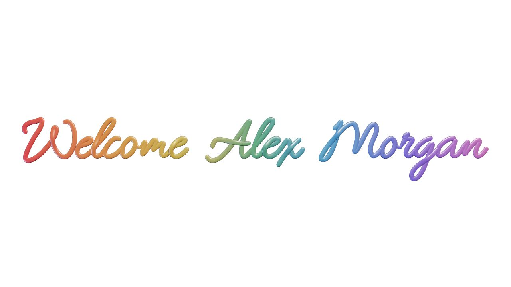

# GPT Launcher

[简体中文](README.md) · **English**

**A personal welcome, before your next conversation.**

A small macOS launcher that writes your name in a rainbow ribbon, weaves it into an animated transition, and opens your installed ChatGPT app. Let the two-breath transition finish, or press Return to get started immediately.

<picture>
  <source media="(prefers-color-scheme: dark)" srcset="docs/images/welcome-dark.png">
  
</picture>

[Download the macOS beta](https://github.com/AnsonZhang0129/gpt-launcher/releases/download/v0.1.0-beta.2/GPT-Launcher-v0.1.0-beta.2-macOS.zip) · [Test record](docs/REVIEW.md) · [Licenses and credits](THIRD_PARTY_NOTICES.md)

> **v0.1.0-beta.2 · Community prerelease**
> An independent, source-available project for noncommercial use. It is not an official OpenAI product or a ChatGPT client. A separate ChatGPT installation is required. The app is not Apple-notarized.

## A welcome with your name

- **Chinese and English interfaces** — follow the system language, or choose and save a language in Settings. Menus, guidance, validation, errors, and preview controls are localized.
- **Your chosen name** — 1–24 English letters and spaces, with case preserved and adaptive single-line layout.
- **Ribbon handwriting** — an adapted stroke font, rounded strokes, pen lifts, branching, and a gradual transition.
- **Light and dark appearances** — light `#FFFFFF` and dark `#181818`, shared by preview and launch.
- **Preview before saving** — watch the animation in Settings, then save it for future launches.
- **Start whenever you want** — continue automatically after two breathing cycles, or press Return or keypad Enter during playback.
- **Local settings** — your name, language, appearance, and app location stay on your Mac; animation resources are bundled.

The ribbon uses one adapted handwriting style. Chinese names, numbers, punctuation, and custom fonts are not supported. Unsupported input produces a message rather than being silently replaced. Interface language does not change this name restriction.

## Install and use

The launcher requires **macOS 13 or later** and an independently installed ChatGPT app. ChatGPT's own system requirements still apply.

1. Download the macOS ZIP from [Releases](https://github.com/AnsonZhang0129/gpt-launcher/releases), unzip it, and move **GPT Launcher.app** into Applications.
2. On first launch, choose an interface language, enter a name, select **Dark** or **Light**, and click **Preview animation**.
3. Choose **Save settings**, or **Save and launch** to start immediately. If ChatGPT cannot be found, use **Locate ChatGPT…**.
4. Open GPT Launcher for future sessions. You can add it to the Dock as your personal entry point.

| Action | Result |
| --- | --- |
| Return / keypad Enter | Skip the animation without clicking it first |
| Escape | Return from the animation to Settings |
| Command+, | Open Settings during playback |
| Hold Option while opening the app | Reopen Settings |

**Distribution:** this beta uses an ad-hoc signature, not a Developer ID signature, and is not Apple-notarized. macOS may block downloaded copies. You can also build from source below. The project does not require disabling Gatekeeper or other system protections.

The source web preview supports both languages too. Use its language selector, or pass `?lang=en` or `?lang=zh` to choose a language explicitly.

## Verification and limits

This localization update passed ten automated tests and the arm64/x86_64 build. Native checks covered Chinese/English switching, menus and validation, preservation of unsaved names, and an English preview playing to completion. Production-model tests cover legacy settings and language persistence.

Name and appearance persistence, Return, keypad Enter, and automatic handoff were previously tested on one Apple Silicon Mac with ChatGPT already running. Short names, longer names, loops, and some connected strokes were visually inspected. The [test record](docs/REVIEW.md) distinguishes those earlier tests from checks for this localization update.

The two-breath handoff is controlled by an animation timer. **It does not inspect ChatGPT's interface to detect loading completion**, so cold-start readiness is not guaranteed. Intel runtime behavior, installation on a clean Mac, and every possible name remain unverified. Building both arm64 and x86_64 slices does not establish hardware testing on both architectures.

Appearance is chosen manually and does not track ChatGPT's theme. Additional characters, fonts, and platforms are outside the current version.

## Privacy

The launcher does not read ChatGPT conversations, account names, or browser data, and does not modify the ChatGPT app. It needs no ChatGPT login, API key, Accessibility permission, or administrator privileges. The animation can play offline; ChatGPT has its own network and account requirements.

Settings are stored at:

```text
~/Library/Application Support/GPT Launcher/settings.json
```

Local diagnostics contain launch events, timing, and window-focus state, not names or conversations.

## Build from source

Install macOS 13+, Xcode Command Line Tools (including Swift), Node.js, and pnpm, then run in the repository:

```sh
pnpm install --frozen-lockfile
pnpm test
pnpm run build:mac
```

The default output is `build/GPT Launcher.app`. Use `pnpm run build` for the web animation alone. Generated apps, dependencies, and personal settings are excluded from the source repository. If your pnpm version asks for dependency build approval, review and approve the pinned esbuild dependency with `pnpm approve-builds` before building.

## License and credits

**Noncommercial forks, modifications, improvements, and sharing are welcome under the license terms.** Original application code uses [PolyForm Noncommercial 1.0.0](https://polyformproject.org/licenses/noncommercial/1.0.0); see [LICENSE](LICENSE). This is a source-available license with commercial-use restrictions, not an OSI open-source license.

Font paths derive from EMS Allure Smooth, adapted here as Ribbon Script, and retain SIL OFL 1.1. Three.js, esbuild, and the Simple Icons path keep their existing licenses. The application's noncommercial restriction does not relicense these components. See [third-party notices](THIRD_PARTY_NOTICES.md).

**License history:** commits `0fe1e92` and `b9bbec6` were published under MIT. The subsequent license change does not withdraw the MIT permissions already granted for those versions.

ChatGPT, GPT, and OpenAI marks belong to their respective rights holders. Source licenses do not grant trademark rights. This project is not affiliated with or endorsed by OpenAI; its app icon is an independent ribbon design.
